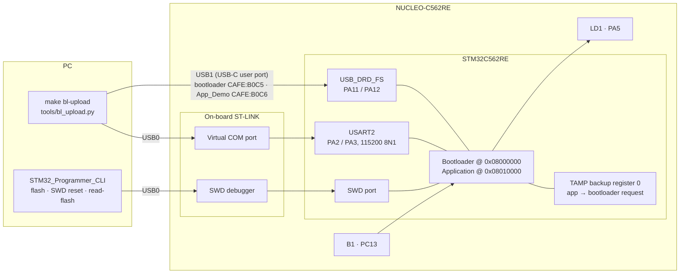
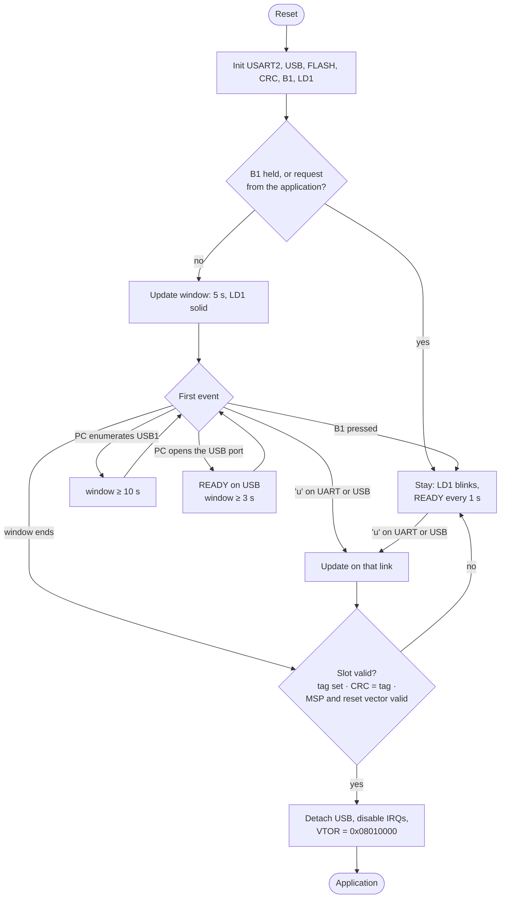

# Bootloader — architecture

How `Projects/Bootloader` works. For how to use it, see [README.md](README.md).

## 1. Block diagram



- **USB0 (ST-LINK)** gives two functions: a virtual COM port wired to USART2 (the "UART" link), and
  SWD (flash, reset).
- **USB1** goes straight to the MCU's USB peripheral, which belongs to whichever program is running.
  The bootloader runs a TinyUSB CDC device on it (`CAFE:B0C5`) and detaches it before jumping to the
  application. App_Demo then presents its own port (`CAFE:B0C6`).

## 2. Software

| Part | Files | Role |
|---|---|---|
| Boot decision | `src/main.c` | B1 check, update window, jump |
| Core | `src/bootloader.c`, `inc/bootloader.h` | Receive and program the image, verify the slot, jump |
| App → bootloader request | `src/bl_request.c`, `inc/bl_request.h` | Linked into applications (`DEPS += Bootloader`) |
| Drivers | UART, USB_CDC (TinyUSB), FLASH, CRC, GPIO, NVIC | Hardware access |
| Host tools | `tools/bl_upload.py`, `tools/read_flash.py` | Upload; name the images in flash |

## 3. Memory map

| Address | Sectors | Content |
|---|---|---|
| `0x08000000` | 0–7 (64 KB) | Bootloader. The chip always starts here |
| `0x08010000` | 8–29 (176 KB) | Active slot: the application |
| `0x0803C000` | 30 | CRC-32 tag of the active slot (`0xFFFFFFFF` = not sealed) |

The map is defined in `linker/memory_map.ld`. `Projects/Secure_Boot` and `tools/seal.py` use the same map.

## 4. Boot decision



The first `u` chooses the link, and the whole update runs on that link. A failed update leaves the
slot without a tag, so the board stays in the bootloader instead of starting a broken image.

## 5. Update protocol (same on both links)

```text
host -> 'u'                               board -> ACK (0x79)
host -> image size, u32 little-endian     board -> erase sectors 8-30, ACK
host -> data chunk (<= 256 bytes)         board -> program, read back, ACK   (repeat)
host -> CRC-32 of the image padded        board -> hardware CRC over 176 KB, compare,
        with 0xFF to 176 KB                        write the tag, ACK
```

Any failure answers NACK (`0x1F`). The CRC is `zlib.crc32`, the same value that `tools/seal.py` writes.

## 6. Entering the bootloader from an application

A running application owns USB1, so it must hand over itself. This works like on Arduino and
Raspberry Pi Pico boards:

1. The PC opens the application's port at 1200 baud and closes it (the "1200-baud touch").
2. The application writes `0xB007AB1E` to TAMP backup register 0 and resets.
3. The bootloader finds the value, clears it, and stays.

The backup register survives a reset; a power cycle clears it. SRAM is not used for this because the
`SRAM1_RST` option byte can erase it on reset.

## 7. Design notes

- **One main loop.** USART2 is polled, and the USB IRQ only queues events for `USB_CDC_Task()`.
  Timeouts use the DWT cycle counter.
- **USART2 RX FIFO.** Handling USB can delay a UART poll longer than one byte takes at 115200 baud.
  The 8-byte FIFO absorbs that.
- **Delayed READY on USB.** Windows serial libraries clear the receive buffer right after opening the
  port, so the bootloader sends READY 150 ms after the port opens.
- **Clean hand-over.** Before jumping, the bootloader detaches USB, disables USART2 and SysTick, and
  clears all NVIC bits, so the application starts as if from reset.
- **`CAFE:B0C5` / `CAFE:B0C6`** use TinyUSB's test vendor ID, which is for development only.
