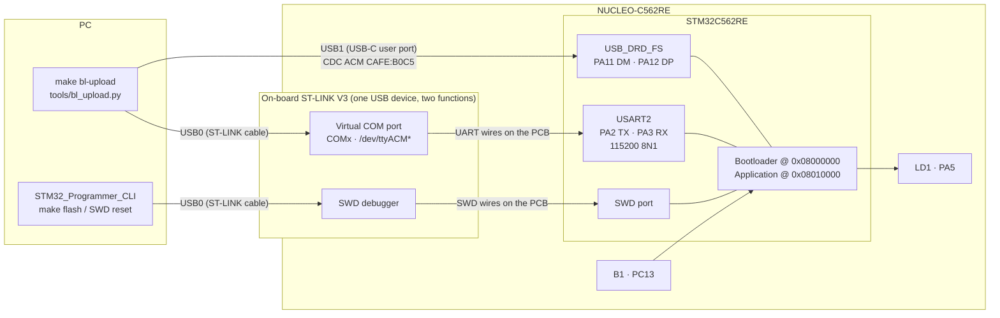
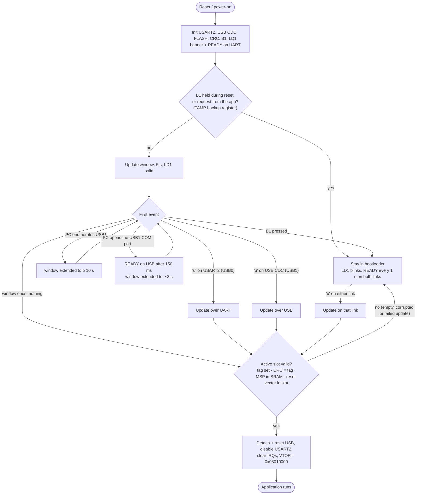

# Bootloader — architecture

How `Projects/Bootloader` is built and how it decides what to do after a reset.
For how to *use* it, see [README.md](README.md).

## 1. Block diagram



**USB0 (ST-LINK cable)** carries two independent functions:

| Function | PC side | What it reaches in the MCU | Used for |
|---|---|---|---|
| Virtual COM port | `COMx` / `/dev/ttyACM*` | USART2, through the ST-LINK chip | UART update link, console log |
| SWD debugger | STM32CubeProgrammer, OpenOCD | Debug port: flash, RAM, reset | `make flash`, SWD reset before an upload |

So the "UART" link is USB on the PC side; only the stretch between the ST-LINK chip and the
STM32 is a real UART. The bootloader cannot tell which PC program sits behind it: it only sees bytes
on USART2.

**USB1 (USB-C user port)** goes straight to the STM32's USB peripheral. The bootloader runs a TinyUSB
CDC ACM device there (`Drivers/USB_CDC`). It exists **only while the bootloader runs**, so the PC
sees a plug-in after every reset and an unplug when the application starts.

## 2. Software layers

| Layer | Files | Role |
|---|---|---|
| Entry + boot decision | `src/main.c` | Banner, B1 check, update window loop, jump |
| Bootloader core | `src/bootloader.c`, `inc/bootloader.h` | Wait for a request, receive + program the image, verify the slot, jump |
| Drivers | `UART`, `USB_CDC` (TinyUSB), `FLASH`, `CRC`, `GPIO`, `NVIC` | Hardware access |
| Host tool | `tools/bl_upload.py` | Finds the port, resets the board, runs the protocol |

## 3. Memory map

| Address | Sectors | Content |
|---|---|---|
| `0x08000000` | 0–7 (64 KB) | Bootloader — the chip always starts here after reset |
| `0x08010000` | 8–29 (176 KB) | Active slot — the application, linked at this address |
| `0x0803C000` | 30 | CRC-32 tag of the active slot (`0xFFFFFFFF` = not sealed) |

The addresses are defined once for the linker in `linker/memory_map.ld`. The bootloader links with
`LAYOUT := bootloader` (`linker/bootloader.ld`), its applications with `LAYOUT := app_slot`
(`linker/app_slot.ld`). The same map is used by `Projects/Secure_Boot` and `tools/seal.py`. Apps for this slot:
`Projects/App_Demo`, `Projects/Root_of_Trust`, `Projects/Secure_FW_Update`.

## 4. Boot decision



- The first `u` decides the link. The whole update then runs on that link only; the console log
  always goes to USART2, and also to USB while its COM port is open.
- A failed update (timeout, size, flash or CRC error) answers NACK and leaves the slot **without a
  tag**, so the check fails and the board stays in the bootloader instead of booting a broken image.

## 5. Which cables give which path

| Connected to the PC | SWD flash / reset | UART update | USB update | `LINK=auto` picks |
|---|---|---|---|---|
| USB0 + USB1 | yes | yes | yes | USB if the bootloader is already waiting, else UART |
| USB0 only | yes | yes | no | UART |
| USB1 only ¹ | no — 1200-baud touch ², else press RESET | no | yes | USB (if the app has a USB port) |
| Neither (powered elsewhere) | no | no | no | — the app boots after 5 s |

¹ USB1 alone does not power the board with a USB-C ↔ USB-C cable; use USB-A ↔ USB-C or another supply.
² Only an application with its own USB port (App_Demo, `CAFE:B0C6`) can be restarted over USB1 —
while it runs, the application, not the bootloader, owns the USB peripheral.

## 6. Update protocol (same bytes on both links)

```text
host -> 'u'                              board -> ACK (0x79)
host -> image size, u32 little-endian    board -> erases sectors 8-30, ACK
host -> data chunk (<= 256 bytes)        board -> programs 16-byte flash words, reads back, ACK  (repeat)
host -> CRC-32 of the image padded       board -> hardware CRC over 176 KB, compares,
        with 0xFF to 176 KB                       writes the tag, ACK
```

Any failure → NACK (`0x1F`). The CRC is `zlib.crc32`, the same value `tools/seal.py` writes.

> **Integrity, not authenticity.** The CRC-32 catches a corrupted or incomplete image. It does not
> prove who built it. For signed images see `Projects/Secure_Boot`.

## 7. Design notes

- **One main loop.** USART2 is polled. The USB IRQ only queues events; TinyUSB handles them in
  `USB_CDC_Task()`, called from the same loop. Sector erase waits on the FLASH IRQ. All timeouts
  use the DWT cycle counter.
- **USART2 RX FIFO.** Servicing USB can delay a UART poll by ~170 µs, longer than one byte at
  115200 baud (87 µs). The 8-byte RX FIFO absorbs that; without it UART uploads lost bytes while
  USB1 was connected.
- **Delayed READY on USB.** Windows serial libraries purge their receive buffer right after
  asserting DTR, so READY is sent 150 ms after the port opens, then every second.
- **Clean hand-over.** Before the jump the bootloader detaches and resets USB (the PC sees an
  unplug), disables USART2, stops SysTick, and clears every NVIC enable/pending bit, so the
  application starts as if from reset.
- **Application → bootloader request.** USB1 belongs to whichever program runs, so a running
  application must cooperate to be updated over USB — as on Arduino and Raspberry Pi Pico: on a
  1200-baud touch App_Demo writes `0xB007AB1E` into TAMP backup register 0 and resets
  (`bl_request.c`). Backup registers survive a system reset (SRAM may not: the `SRAM1_RST` option
  erases it) and are cleared by a power cycle. The bootloader clears the request and stays.
  Without a cooperating application the fallbacks are B1 + RESET, the SWD reset, or a watchdog.
- **VID:PID `CAFE:B0C5`** (bootloader) / **`CAFE:B0C6`** (applications) use TinyUSB's test vendor ID, fine for development only
  (`Drivers/USB_CDC/inc/usb_cdc.h`).
